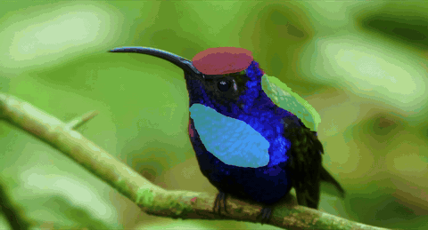
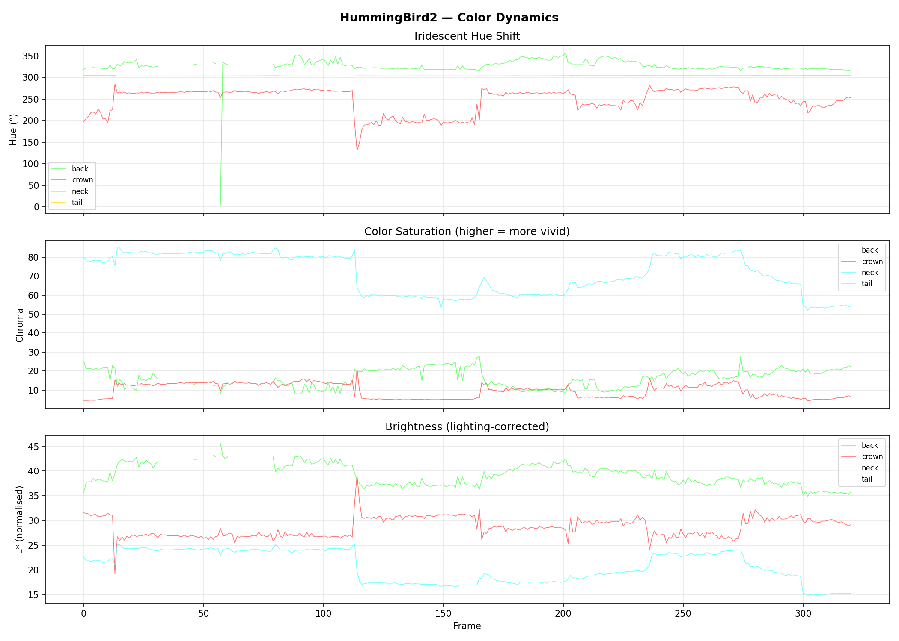
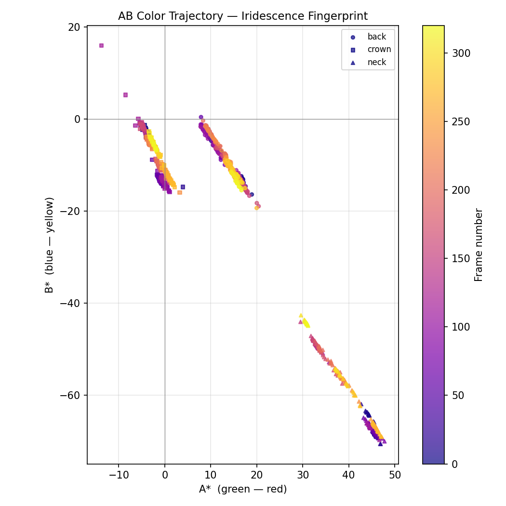
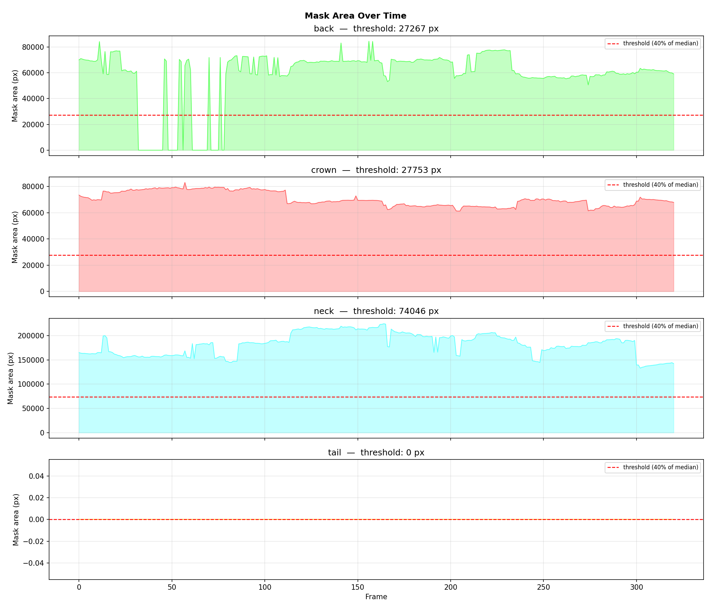

# Iridescence Lab

**Multi-species structural color analysis pipeline for iridescent birds and insects.**

Annotate body-part regions in video → run GPU segmentation on Google Colab → analyze color dynamics locally. Built with Streamlit, SAM 2, and CIE LAB color science.

---

## Demo



*SAM 2 mask overlay showing per-part segmentation (crown, back, neck) tracked across the full video. [Full video on YouTube ↗](https://www.youtube.com/watch?v=2jDET2lUvRI)*

---

## Pipeline

```
┌─────────────┐     ┌──────────────────────┐     ┌─────────────────┐
│  1. Annotate│────▶│   2. Segment (Colab) │────▶│   3. Analyze    │
│  Streamlit  │     │   SAM 2  •  T4 GPU   │     │   Streamlit     │
│  freehand   │     │   ~15 min / 2600 fr  │     │   iridescence   │
│  mask paint │     │   → masks.npz        │     │   metrics       │
└─────────────┘     └──────────────────────┘     └─────────────────┘
```

**Step 1 — Annotate** (local, no GPU needed)
Paint each body part (crown, back, neck, …) on a few representative frames using a freehand brush. The app extracts video frames automatically and saves your painted masks to `annotation_masks.npz`.

**Step 2 — Segment** (Google Colab, free T4 GPU)
The app generates a ready-to-run `.ipynb`. Upload your video + `keyframes.json` + `annotation_masks.npz` to Google Drive and run all cells. SAM 2 propagates your painted masks across the full video using `add_new_mask()` prompts — one mask per body part per frame — and saves `masks.npz` (~50 MB for a 300-frame clip).

**Step 3 — Analyze** (local)
Upload `masks.npz` back into the app. It computes per-frame hue, chroma, and brightness in CIE LAB space, then derives iridescence metrics and renders interactive charts.

---

## Color Analysis

Color is extracted in **CIE LAB** space — a perceptually uniform space where equal numerical distances correspond to equal perceived color differences.

| Metric | Formula | What it means |
|---|---|---|
| Hue | `arctan2(B*, A*) mod 360°` | Angle in the color wheel |
| Chroma | `√(A*² + B*²)` | Vividness / distance from grey |
| Hue spread | `√(−2 ln R)` where `R = ‖mean(e^iθ)‖` | Circular std dev of hue across frames |
| Hue velocity | `mean(‖θₜ₊₁ − θₜ‖)` | Frame-to-frame color shift rate |
| **Iridescence index** | `hue_spread × chroma_mean / 100` | Combined structural color score |

Hue is treated as a circular variable (0° ≡ 360°) using directional statistics (Fisher, 1993) to avoid wrap-around artifacts. A high iridescence index requires *both* a large hue range *and* high saturation — a desaturated feather with noisy hue measurements does not score high.

### Sample output — Violet-crowned Woodnymph (*Thalurania colombica*)







---

## Installation

Requires Python 3.10+. No GPU needed for local steps.

```bash
git clone https://github.com/parishamaheshj18/IridescenceAnalyzer.git
cd IridescenceAnalyzer
bash setup.sh
source .humming/bin/activate
streamlit run app.py
```

The app opens at `http://localhost:8501`.

---

## Usage

### Adding a new species
1. Go to **Home** → Keep your Video in Data/[SpeciesName] Folder → fill in species name → upload your video → **Create**
2. Go to **Annotate** → add a keyframe → paint each body part → **Save keyframes.json**
3. Go to **Segment** → download the generated `.ipynb`
4. Upload video + `keyframes.json` + `annotation_masks.npz` to `MyDrive/Iridescence Lab/{species}/`
5. Open the notebook in Colab → Runtime → T4 GPU → Run all
6. Download `masks.npz` from Drive → upload it in the **Segment** tab
7. Go to **Analyze** → explore charts → download CSV

### Annotation tips
- Annotate **3–6 keyframes** spread across the video, especially at frames where the bird changes angle or lighting changes significantly
- SAM 2 uses each painted mask as a hard constraint — the more precise your painting, the better the tracking
- Use **Skip (not visible)** for frames where a body part is occluded

---

## Project structure

```
app.py                  Home page — species library
pages/
  1_Annotate.py         Freehand mask painting, keyframe management
  2_Segment.py          Colab notebook generation, masks.npz upload
  3_Analyze.py          Color analysis, iridescence metrics, export
utils/
  video.py              Frame extraction, overlay video export
  analysis.py           LAB color extraction, iridescence metrics
  colab_gen.py          Auto-generates SAM 2 Colab notebook
Data/
  {species}/
    {video}.mov         Source video
    keyframes.json      Annotated frame indices + part status
    annotation_masks.npz  Painted masks (input to SAM 2)
    masks.npz           SAM 2 propagated masks (output from Colab)
    parts.json          Part names + display colors
    output/             color_data.csv, plots, mask_overlay.mp4
```

---

## Dependencies

| Package | Purpose |
|---|---|
| `streamlit` | Web app framework |
| `streamlit-drawable-canvas` | Freehand mask painting |
| `opencv-python` | Frame extraction, video export |
| `scikit-image` | RGB → CIE LAB conversion |
| `numpy` / `pandas` | Numerical analysis |
| `matplotlib` | Charts |
| `Pillow` | Image manipulation |
| SAM 2 (Colab only) | Video segmentation |

---

## References

- Kirillov et al. (2024). *SAM 2: Segment Anything in Images and Videos.* [arXiv:2408.00714](https://arxiv.org/abs/2408.00714)
- CIE (1976). *Colorimetry, 2nd ed.* Commission Internationale de l'Éclairage.
- Fisher, N.I. (1993). *Statistical Analysis of Circular Data.* Cambridge University Press.
